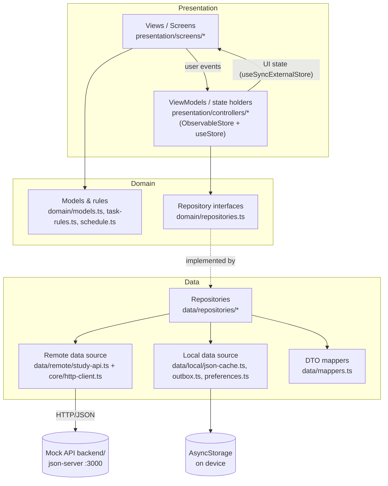
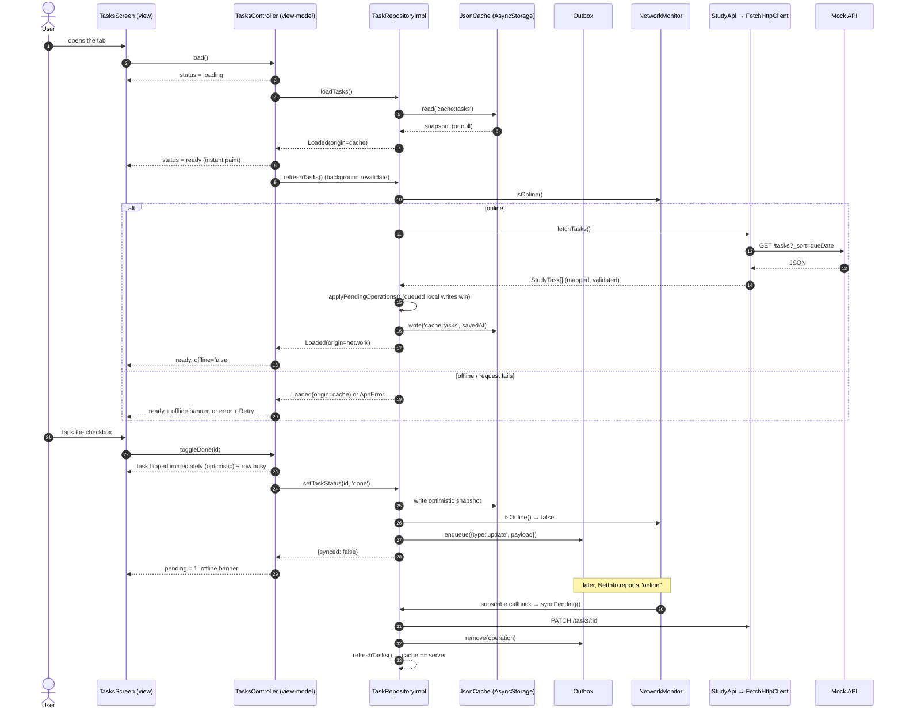
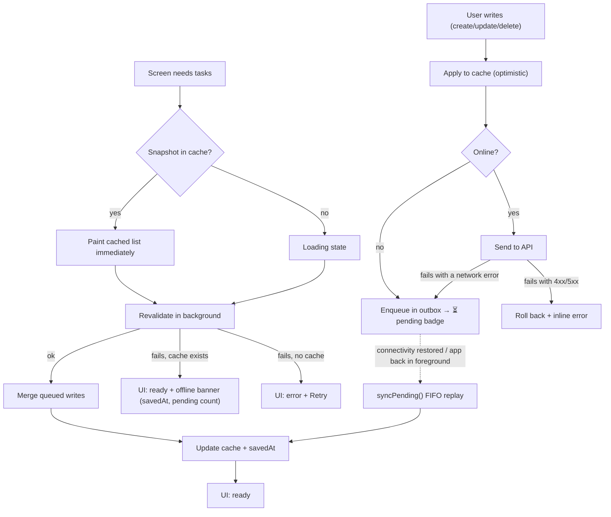

# App Architecture

> Graded under **A3 — Architecture & Data Design**. This describes what is in `app/src/` and why.

---

## 1. Layers



| Layer | Our implementation (folders / main classes) | Owner (member) |
|-------|---------------------------------------------|----------------|
| Presentation | `presentation/screens` (7 screens), `presentation/components` (shared UI + states), `presentation/theme` (tokens, provider), `navigation/` | Hùng (Tasks, Detail), Đức Anh (Today, Timetable), Tergel (Form, Courses, Settings, theme) |
| ViewModel | `presentation/controllers`: `TasksController`, `TaskDetailController`, `TaskFormController`, `HomeController`, `TimetableController`, `CoursesController`, `SettingsController` — plain classes over `ObservableStore` | same split as above |
| Domain | `domain/models.ts` (entities + enums), `domain/task-rules.ts` (sorting, filters, summary, due labels, **accent-insensitive search**), `domain/schedule.ts` (weekday maths), `domain/repositories.ts` (contracts) | Hùng (`task-rules`, contracts), Đức Anh (`schedule`) |
| Data | `data/repositories` (`TaskRepositoryImpl`, `CachedListRepository`, catalog factories), `data/remote/study-api.ts`, `data/local` (`JsonCache`, `Outbox`, `PreferencesStore`, **`TaskDraftStore`**, storage adapters), `data/mappers.ts` | Hùng (task repository + outbox), Tergel (catalog repos, mappers, draft store) |
| Core / infra | `core/http-client.ts` (fetch + timeout + error mapping), `core/errors.ts` (`AppError`), `core/network-monitor.ts` + `netinfo-monitor.ts`, `core/clock.ts` | shared, reviewed by all |
| Composition root | `src/app/services.ts` — the only place where interfaces meet implementations | Hùng |

**The rule we enforce:** a screen never imports `fetch`, `AsyncStorage` or `study-api`; it imports a controller
and gets its controller from `services` (or from a test fake). `npm run typecheck` plus code review keeps it true.

---

## 2. State Management

**Our choice:** one **controller class per screen** (the ViewModel) extending `ObservableStore<S>`, bound to React
with `useSyncExternalStore`.

**Why:**

- The screen state is small and local (a list, a filter, a form). No global store is needed, so no global store
  is added — that also removes the "which state lives where?" question in the oral defense.
- Controllers are **plain TypeScript classes**: `app/src/presentation/__tests__/tasks-controller.test.ts` drives
  a controller with a fake repository and asserts the emitted states, without rendering React.
- `useSyncExternalStore` is React's built-in way to subscribe to an external store, so there is no custom
  re-render logic to defend and no third-party state library to justify.
- Controllers are created per screen with `useMemo` and reload on focus (`useFocusEffect`), which makes
  rotation / process death a non-event: state is rebuilt from the repository cache.

Rejected: Redux/Zustand (global store for 7 independent screens — unnecessary), TanStack Query
(would hide the cache/outbox policy we want to own and defend), React Context for data (re-render fan-out and
no clean test seam).

How a screen's UI state is modelled (`presentation/state/async-slice.ts` + each controller):

```text
status: 'idle' | 'loading' | 'ready' | 'empty' | 'error'   // the four required states, with empty and
                                                          // error kept apart (see below)
error : AppError | null                             // userMessage shown; canRetry decides whether a
                                                    // Retry button exists at all
data  : … | null
plus screen-specific flags: isRefreshing, offline, pending, busyTaskIds, actionError
```

**`empty` is a first-class status, not an error.** A list with no rows (`SCR-02/05/06`) and a record that no
longer exists on the server (`SCR-03` detail, `SCR-04` edit) are both *successful* reads with nothing to show.
Folding them into `error` produces the bug every reviewer looks for: a **Retry button that reloads the same
nothing**, forever. The view-models set `status: 'empty'` and the screens render `EmptyState` with an action that
moves the user *forward* (create a task, go back to the list). A genuine failure still sets `status: 'error'`,
and there `AppError.canRetry` decides whether the Retry button is rendered — transient failures (offline, timeout,
408/429/5xx) get it, permanent ones (400/403/404/422, unparsable body) get an explanation and *Quay lại* instead.
Both halves are covered: unit tests in `task-detail-controller.test.ts` / `task-form-controller.test.ts` /
`errors.test.ts`, plus three end-to-end checks over the running build.

---

**Out-of-order responses.** `load()` runs on every screen focus and pull-to-refresh can start a second request
while the first is still open, so two responses can arrive in the wrong order. Each view-model owns a
`RequestTracker` (`presentation/state/request-tracker.ts`): `begin()` hands out a token, and a response is applied
only when `isLatest(token)` is still true — the slower, older snapshot is dropped instead of overwriting fresher
data. The same tracker carries a local-write version, so a background `revalidate()` never reverts an optimistic
toggle that happened while its request was in flight. Both behaviours are unit-tested
(`tasks-controller.test.ts` → *ignores a slow earlier load…*, *does not let a background refresh revert an
optimistic toggle*).

**Time-dependent labels.** "Hôm nay", "Còn 2 ngày", the exam countdown — all rendered from `useNow()` instead of a
`new Date()` captured once at render. The hook ticks once a minute and re-renders immediately when the app returns
to the foreground, so an app left open overnight cannot keep showing yesterday's answers.

## 3. Data Flow

End-to-end for the most important flow — **opening the Tasks screen, then completing a task while offline**:



Search, filters and the course scope are **pure functions over the already-loaded list** (`domain/task-rules.ts`)
— typing never triggers a request, which is what keeps search working in airplane mode.

Where each piece of state lives:

| State | Lives in | Survives rotation / process death? |
|---|---|---|
| Screen list, filter, busy rows, banners | `TasksController` instance (per screen) | Rebuilt from the cache on focus → yes, data survives; UI-only flags reset |
| Unsaved form input | `TaskFormController` + `TaskDraftStore` (`draft:task-form[:<id>]`) | **Yes** — every keystroke is persisted and restored on the next mount, with a notice and a discard action (verified after a real reload in the running build) |
| Theme preference | `PreferencesStore` (AsyncStorage) | Yes |
| Tasks / courses / sessions / profile snapshots | `AsyncStorage` (`cache:<key>` + `savedAt`) | Yes — this is what makes airplane mode work |
| Pending writes | `Outbox` (AsyncStorage, FIFO) | Yes — kills the process mid-flight and nothing is lost |

---

## 4. Offline Strategy

| Data | Stored where | Read policy | Write policy | Conflict handling |
|------|--------------|-------------|--------------|-------------------|
| `StudyTask[]` (+ `savedAt`) | AsyncStorage key `cache:tasks` | Cache first → paint → revalidate in background; refresh failure keeps the cache and shows the offline banner | Optimistic local write, then API call; if the device is offline the operation goes to the outbox | Queued writes are **superimposed** on the server list (`applyPendingOperations`), so a stale server response never overwrites a local edit. Outbox replays FIFO; a `404` during replay drops the operation |
| `Course[]`, `Session[]`, `StudentProfile` | `cache:courses`, `cache:sessions`, `cache:profile` | Cache first, revalidate in background, fall back to cache on failure | Read-only in the app | n/a (server is the source of truth) |
| Theme preference | `prefs:theme` | Read once at startup | Always local | n/a |
| Pending operations | `outbox:operations` | Read by the repository | Appended on every offline write, removed after replay | FIFO order preserves create → update → delete semantics; local ids (`local-…`) are rewritten in place instead of sending an update for an id the server has never seen |



**Why only connectivity failures are queued.** A `4xx` (validation error) or `5xx` will not succeed by being
retried later, and queueing it would hide a real bug from the user. `AppError.kind === 'offline'` is the only
trigger for the outbox; a `timeout` is treated as "unknown result" and surfaces as an error the user can retry.

**Two guarantees in the queue itself.** Both are cheap to state and easy to get wrong:

* *Serialised mutations.* `Outbox` is a read-modify-write on one storage key, so two writes started in the same
  tick would each read the old list and the loser would silently disappear. Every mutation goes through a single
  promise chain (`mutationChain`), i.e. `enqueue()`/`update()`/`remove()`/`clear()` are FIFO.
* *Single-flight replay.* `syncPending()` is called from three places — the connectivity listener, the
  **Đồng bộ ngay** button in Settings, and the app returning to the foreground (`AppState === 'active'`, because a
  phone that was already online would otherwise never replay). A `syncInFlight` promise makes concurrent callers
  share one run, so a queued `create` is POSTed exactly once.

**Storage choice.** The dataset is a semester of tasks and ~10 sessions, so JSON snapshots in AsyncStorage are
enough and keep the whole data layer readable (and testable on web). SQLite would be the right tool for
thousands of rows, joins or partial updates; that trade-off is stated here deliberately.

**Not solved (and why).** Two devices editing the same task simultaneously is last-write-wins; there is no
server-side version or timestamp comparison. The scope is a single-student app (`docs/proposal.md` §4), so the
conflict is not reachable in the way the app is used.

```text
Security note: this app stores no credentials and no tokens (no accounts in scope). The cached data is
course/task metadata, not sensitive personal data, and it is removed on logout — there is no logout — or with
"Xoá dữ liệu lưu offline" in Settings.
```

---

## 5. Project Structure

```text
app/
├── App.tsx                      # providers (SafeArea, Theme) + navigation
├── app.config.ts                # Expo config; reads EXPO_PUBLIC_API_URL into extra.apiBaseUrl
├── .env.example                 # API base URL / timeout / environment
├── index.ts                     # registerRootComponent
└── src/
    ├── app/services.ts          # composition root (the only place with `new SomethingImpl()`)
    ├── config/env.ts            # runtime config + per-platform defaults + trailing-slash normalisation
    ├── core/
    │   ├── errors.ts            # AppError kinds → user messages, retry policy
    │   ├── http-client.ts       # fetch + AbortController timeout + JSON + error mapping
    │   ├── network-monitor.ts   # interface + fakes (AlwaysOnline / Offline)
    │   ├── netinfo-monitor.ts   # NetInfo implementation
    │   └── clock.ts             # injectable clock
    ├── domain/
    │   ├── models.ts            # Course, Session, StudyTask, StudentProfile, TaskInput/TaskPatch
    │   ├── repositories.ts      # TaskRepository, CourseRepository, ScheduleRepository, ProfileRepository
    │   ├── task-rules.ts        # isOverdue, dueLabel, filterTasks, sortTasks, summarize, upcomingDeadlines, nextExam
    │   └── schedule.ts          # isoWeekday, sessionsForDay, nextSessionInfo (running vs next), weekDates
    ├── data/
    │   ├── mappers.ts           # DTO → domain, with fallbacks and parse errors
    │   ├── remote/study-api.ts  # typed endpoints
    │   ├── local/               # key-value-store, async-storage, json-cache, outbox, preferences, task-draft-store
    │   └── repositories/        # task-repository.ts, cached-list-repository.ts, catalog-repositories.ts
    ├── presentation/
    │   ├── controllers/         # 7 view-models (today, tasks, detail, form, timetable, courses, settings)
    │   ├── state/               # ObservableStore + useStore, AsyncSlice types
    │   ├── components/          # Screen, Card, Pill, TaskCard, SessionRow, states, banners, icons
    │   ├── screens/             # 7 screens
    │   ├── theme/               # tokens.ts, theme-context.tsx
    │   ├── hooks/                # use-auto-sync.ts (replay the outbox), use-now.ts (labels that cannot go stale)
    │   └── format.ts            # date/time/label formatting + due-date parsing
    └── navigation/              # root-navigator.tsx, types.ts
```

---

## 6. Design Decisions

| Decision | Alternatives considered | Why we chose this |
|---|---|---|
| Strict **MVVM with a hand-written observable store** | Redux, Zustand, MobX, TanStack Query | Smallest surface we can explain line by line; controller unit tests run in ~1 s with no React; no extra dependency in the oral-defense path. |
| **`AppError` as the single error type** across the data layer | Let `fetch`/`TypeError` bubble into the UI | One place maps socket/timeout/HTTP/JSON failures to a Vietnamese message and a retry decision; screens never parse error strings. |
| **Repository contracts in `domain/`**, implementations in `data/` | Controllers instantiate repositories directly | Enables fakes in tests and keeps the dependency direction pointing inwards (view-models know nothing about `fetch`/AsyncStorage). |
| **Fail-fast mapping** instead of skipping bad rows | Per-row `try/catch` with a "1 row skipped" notice | A list that silently drops the overdue task is worse than an honest error + retry; the contract is documented in `api-integration.md` §4 and locked by `mappers.test.ts` |
| **Cache + outbox** instead of "online only" | Optimistic UI without persistence; SQLite + migration | Both are real requirements (§4.6 of the brief): offline read *and* offline write. Cache + outbox is the smallest mechanism that satisfies both, and it is fully covered by repository tests. |
| **Merge queued writes into every server response** | Replace the cache with the server list | Without the merge, a pull-to-refresh while a write is queued silently reverts the user's change. This exact bug is covered by a test (`does not lose a queued change…`). |
| **Config-driven base URL** (`EXPO_PUBLIC_API_URL` → `expo-constants` → `config/env.ts`) | A constant in a `constants.ts` | Requirement §4.7; also lets the same binary target emulator, simulator, LAN device and web preview via `/api` proxy. |
| **DTO mappers with validation** | `as StudyTask` cast of the JSON | The API is a mock today; a real backend will send surprises. A missing `dueDate` becomes a `parse` error, not `Invalid Date` in the UI. |
| Metadata only persistence, **no tokens** | Secure store for a session | The scope has no accounts; adding auth storage would add risk without graded value. |
| **Form drafts in the same key/value store** (`TaskDraftStore`) | Keep the form in memory only; or a global form store | §6 (B1) requires input to survive rotation and Android may kill a backgrounded activity. The draft is namespaced per task (`draft:task-form:<id>`), cleared on save, and never queued for sync. |
| **Search and filtering in the domain layer** (pure functions) | Query the API (`?q=`) | Works offline, is instant on a semester-sized list, and is unit-tested without a mock server (`searchTasks`, `filterTasks`). |
| **Lint + typecheck + tests behind one command** (`make verify`) | Rely on GitHub Actions | The starter deliberately has no CI (it would spend the GitHub Education minutes); a single local command keeps the same guarantee and is what we run before every commit. |
