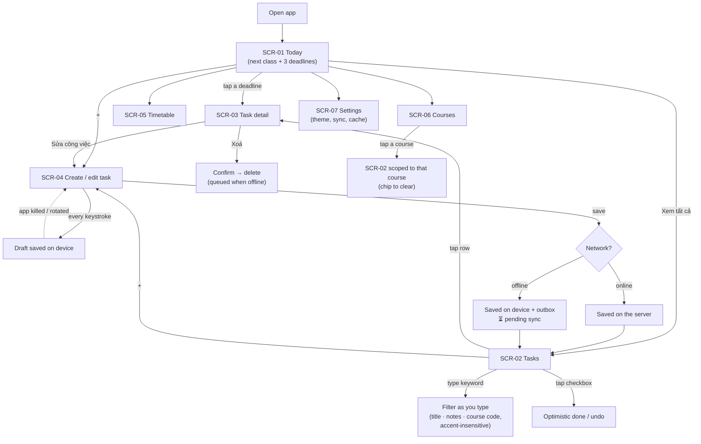
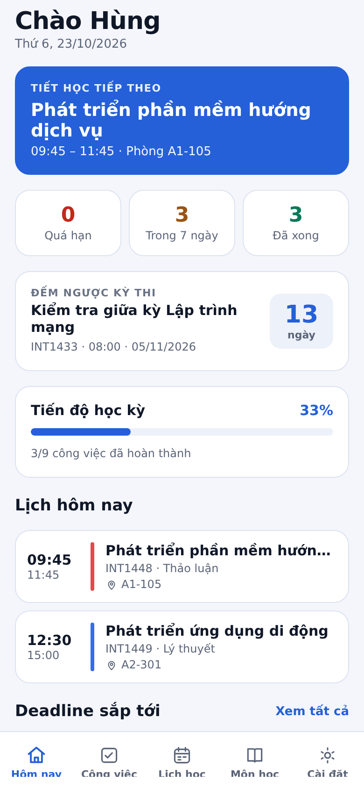
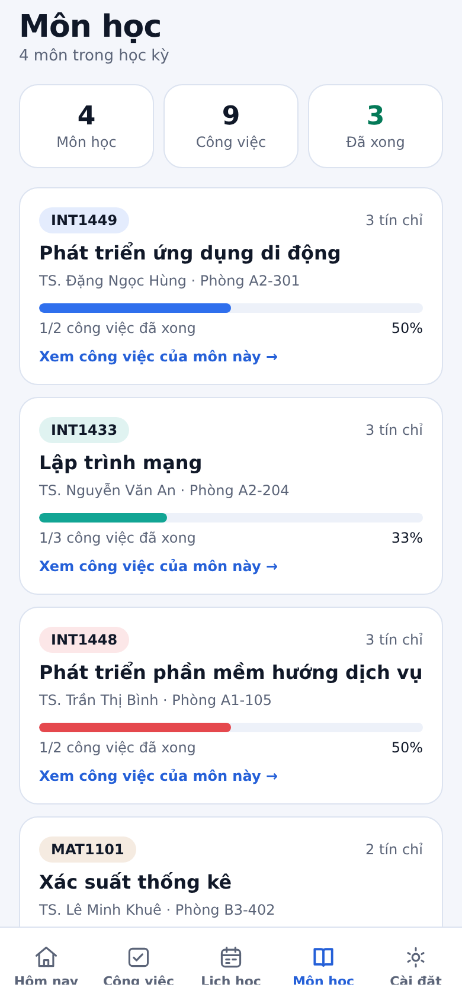
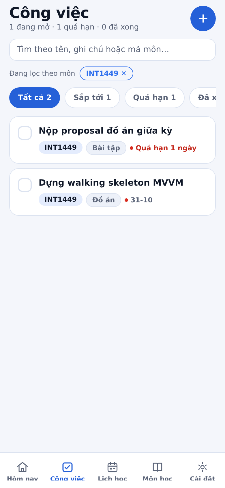
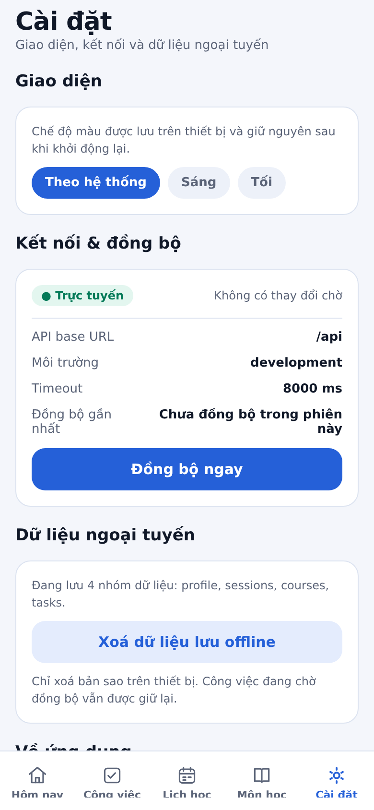
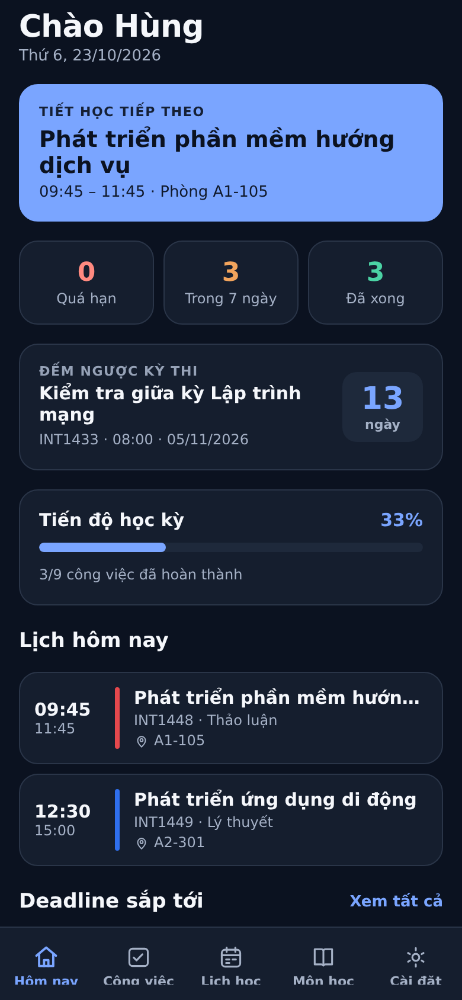
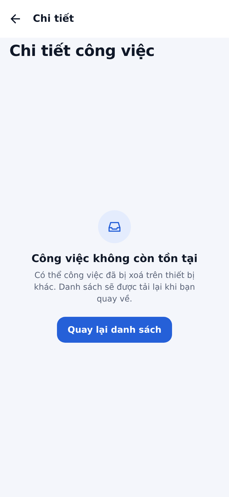

# UI/UX Design

> Graded under **A2 — UI/UX Design**. Everything here is implemented in `app/src/presentation/`.
> Screenshots in this document were taken from the running app (see `docs/asset/`).

---

## 1. Users & Goals

### 1.1 Product goal

- **Problem solved:** students keep their weekly timetable and their deadlines in two different places, so a
  deadline is discovered too late — usually when there is no network to check the LMS.
- **Value delivered:** in **under 3 taps and 2 seconds** the student sees what is due next and which class is
  next — from the home screen, with no login, even offline.

### 1.2 Personas

| | Persona 1 — "Hùng, năm 3" | Persona 2 — "Tergel, sinh viên trao đổi" |
|---|---|---|
| **Who** | 21, CNTT, 4 subjects, 9 class periods a week, does the group project | 20, exchange student, new campus, follows the timetable strictly, mixes Vietnamese and English |
| **Context of use** | Between buildings, one hand, 4G that drops in the lab basement; opens the app 5–8 times a day for a few seconds | At the start of the day and right before class; needs the room number, not the syllabus |
| **Needs / pain points** | "What is due tomorrow?", "did I hand it in?", "which subject was that essay for?"; forgets a deadline announced verbally in class | "Where is my next class?", "what room?"; does not know the campus naming |
| **What the app gives** | Today screen with the 3 nearest deadlines, overdue/this-week counters, one-tap completion, search by keyword | Timetable with the current day pre-selected, room and theory/lab labels, course colours, per-course drill-down |

---

## 2. User Flows

**No authentication flow:** the app is a personal, single-student tool in this scope (see
`docs/proposal.md` §4 — accounts are out of scope), so an unauthenticated user is the only user and every screen
is available immediately. The student profile is read-only data from the API.

---

## 3. Screen Inventory

| ID | Screen | Purpose | Main components | Data source |
|:--:|--------|---------|-----------------|-------------|
| `SCR-01` | **Today** (Hôm nay) | Answer "what now?" — next class, nearest deadlines, semester progress | Hero card (**đang diễn ra** / **tiếp theo**, with the weekday when not today), **exam countdown card**, 3 stat tiles, progress bar, session list, deadline list | `profile`, `courses`, `sessions`, `tasks` |
| `SCR-02` | **Tasks** (Công việc) | Find, filter and complete work | Search field, course-scope chip, filter chips with counts, task rows, FAB, pull-to-refresh | `tasks`, `courses` |
| `SCR-03` | **Task detail** (Chi tiết) | Read one task fully and act on it | Status pills, due/remaining rows, notes, complete/edit/delete actions, and the *not-found* state when the task was deleted elsewhere | `tasks`, `courses` |
| `SCR-04` | **Create / Edit task** (Thêm công việc) | Capture a deadline fast, with validation | Text input, course chips, due-date input + 4 quick chips, type/priority chips, notes, draft-restored notice | `courses`, `tasks`, local draft |
| `SCR-05` | **Timetable** (Lịch học) | Find the next class and its room | Week day strip (current day pre-selected), day session list, week summary | `sessions`, `courses` |
| `SCR-06` | **Courses** (Môn học) | See the semester per subject and jump into its work | 3 stat tiles, tappable course cards with completion bars | `courses`, `tasks` |
| `SCR-07` | **Settings** (Cài đặt) | Theme, connection diagnostics, offline queue and cache | Theme chips, status pill, API diagnostics, sync / clear-cache actions | `config`, local storage, `network` |

The **exam countdown** card (`SCR-01`) answers the topic's fourth question — "when is my next exam?" — with the
days left in large type, the course code and the date, and it turns amber in the last three days. It is computed by
`nextExam()` / `examCountdown()` in `domain/task-rules.ts`; a finished or past exam is never counted.

Shared components: `Screen`, `Card`, `Pill`, `StatTile`, `ProgressBar`, `FilterChips`, `TaskCard`,
`SessionRow`, `CourseCard`, `LoadingState`, `EmptyState`, `ErrorState`, `OfflineBanner`, `InlineNotice`, `Icon`.

---

## 4. Wireframes

Low-fidelity wireframes live in `docs/asset/wireframes/` — one per functional screen, drawn before the
implementation and kept next to it, so a reviewer can compare intention with the real thing:

| Screen | Wireframe | Implemented |
|--------|-----------|-------------|
| `SCR-01` Today | [`wireframes/today.svg`](asset/wireframes/today.svg) | `asset/home.png` |
| `SCR-02` Tasks | [`wireframes/tasks.svg`](asset/wireframes/tasks.svg) | `asset/tasks.png` |
| `SCR-03` Task detail | [`wireframes/task-detail.svg`](asset/wireframes/task-detail.svg) | `asset/task-detail.png` |
| `SCR-04` Create / edit | [`wireframes/task-form.svg`](asset/wireframes/task-form.svg) | `asset/task-form.png` |
| `SCR-05` Timetable | [`wireframes/timetable.svg`](asset/wireframes/timetable.svg) | `asset/timetable.png` |
| `SCR-06` Courses | [`wireframes/courses.svg`](asset/wireframes/courses.svg) | `asset/courses.png` |
| `SCR-07` Settings | [`wireframes/settings.svg`](asset/wireframes/settings.svg) | `asset/settings.png` |

| Today (wireframe) | Tasks (wireframe) |
|:---:|:---:|
|  |  |

The wireframes came first: grey boxes for structure, one solid element per screen for the single most important
thing on it (the running/next class on Today), and the tab bar always drawn because it tells a reviewer that the
five sections are peers. They are still useful after implementation — a "does the screen still do what the
wireframe promised?" review is faster than reading `tasks-screen.tsx`.

The same screens after implementation (real screenshots from the running app):

| Today | Tasks | Search | Task detail |
|:---:|:---:|:---:|:---:|
|  |  |  |  |

| Create / edit | Timetable | Courses | Course → tasks |
|:---:|:---:|:---:|:---:|
|  |  |  |  |

| Settings | Dark theme | Tablet / landscape |
|:---:|:---:|:---:|
|  |  |  |

---

## 5. Design Tokens

Implemented once in `app/src/presentation/theme/tokens.ts` and read through `useTheme()` — no screen
hard-codes a colour.

### 5.1 Colors

| Token | Light | Dark | Usage |
|-------|-------|------|-------|
| `primary` | `#2560D8` | `#7AA5FF` | Primary actions, active tab, selection, links |
| `primarySoft` | `#E4ECFD` | `#1C2A4A` | Secondary buttons, icon badges |
| `secondary` | `#0A7A6D` | `#3ED0BC` | Secondary accent (charts, tooltips) |
| `background` | `#F4F6FB` | `#0B1220` | Screen background |
| `surface` | `#FFFFFF` | `#151E2E` | Cards, tab bar |
| `surfaceMuted` | `#EDF1F9` | `#1E293B` | Inputs, skeletons |
| `border` | `#DCE3F0` | `#2A3548` | Card/input borders (hairline) |
| `text-primary` | `#101828` | `#F5F7FB` | Titles, body |
| `text-secondary` | `#5B6478` | `#A5B1C6` | Meta, helper text |
| `error` | `#C4281C` | `#FF8A80` | Overdue, errors |
| `success` | `#047A58` | `#4BD3A4` | Completed, online |
| `warning` | `#9A5313` | `#F2A45C` | Due today, offline banner, pending sync |

Course colours come from the API (`courses[].color`) so a subject keeps the same accent for its pill tint, its
timetable bar and its progress bar. They are **decorative only**: the course code inside a pill is rendered in
`text-primary`, because the app cannot know whether a colour the server sends is readable.

**Contrast is a test, not a promise.** The five semantic colours above were re-tuned in the light theme so that
every pair we paint text on reaches **WCAG AA (4.5:1)** — measured, not eyeballed:
`warning` on `warningSoft` was 3.92, `success` on `surface` 3.90, `primary` on `background` 4.21. The numbers are
now guarded by `app/src/presentation/__tests__/theme-contrast.test.ts` (34 pairs × 2 themes), so lightening a
token later fails the build instead of shipping an unreadable pill. The dark palette already passed and is
unchanged.

### 5.2 Typography & spacing

| Token | Value | Usage |
|-------|-------|-------|
| `display` | 26 / 700, letter-spacing −0.4 | Screen titles |
| `title` | 20 / 700 | Hero card title |
| `heading` | 16 / 600 | Card titles |
| `body` | 15 / 400 | Task titles, notes |
| `label` | 13 / 600 | Pills, meta |
| `caption` | 12 / 500 | Due labels, helper text |
| `spacing-unit` | 8 (scale 4 · 8 · 12 · 16 · 24 · 32) | All padding and gaps |
| `radius` | 8 · 12 · 16 · 24 · 999 | Inputs, cards, pills |
| `touch-target` | 44 | Minimum size of every pressable |
| `max-content-width` | 720 | Caps the reading width on tablets, landscape and web |

---

## 6. UI States

Every screen that loads data implements all four states. They are **shared components**, not ad-hoc markup, so
a missing state is visible in code review.

| Screen | Loading | Success | Empty | Error (with retry) |
|--------|---------|---------|-------|--------------------|
| `SCR-01` Today | Skeleton rows + spinner (`LoadingState`) | Hero card + exam countdown + stats + lists | "Học kỳ đang trống" + *Thêm công việc* | `ErrorState` → *Thử lại* |
| `SCR-02` Tasks | Skeleton rows | Filtered + searched list with counts | "Chưa có công việc nào" + CTA; per filter "Không có mục nào ở đây"; search miss "Không tìm thấy công việc" + *Xoá tìm kiếm* | `ErrorState` → *Thử lại*; stale cache → `OfflineBanner` |
| `SCR-03` Detail | Skeleton | Full detail + actions | Task deleted elsewhere → `EmptyState` "Công việc không còn tồn tại" + *Quay lại danh sách* | `ErrorState` → *Thử lại* only when retrying can help; action failures → `InlineNotice` |
| `SCR-04` Form | Skeleton | Form with defaults or the restored draft | Editing a task that was deleted elsewhere → `EmptyState` + *Quay lại danh sách* | Global `ErrorState` (retry only when retrying can help); per-field validation messages; save failure → `InlineNotice` |
| `SCR-05` Timetable | Skeleton | Day list | "Không có tiết học" for that weekday | `ErrorState` → *Thử lại* |
| `SCR-06` Courses | Skeleton | Course cards | "Chưa có môn học" | `ErrorState` → *Thử lại* |
| `SCR-07` Settings | n/a (local data) | Diagnostics card | "Chưa có dữ liệu nào được lưu" | Inline error notice |

Evidence screenshots (real, from the running build):

| Empty | Error + retry | Not found (record gone) | Offline (stale cache) |
|:---:|:---:|:---:|:---:|
|  |  |  |  |

### 6.1 Two rules that keep the states honest

**Empty is not Error.** `ScreenStatus` has a separate `empty` value for "the request succeeded and there is
nothing to show": a list with no rows, or a record that no longer exists because it was deleted on another
device. Mixing the two produces the classic bug of a Retry button that reloads to the same empty result forever.
The not-found case therefore renders `EmptyState` with *Quay lại danh sách* — a way **forward**, not a repeat.
`SCR-02/05/06` use `empty` for "no rows"; `SCR-03/04` use it for "this record is gone". Both are covered by
tests (`task-detail-controller.test.ts`, `task-form-controller.test.ts`) and by an end-to-end check.

**Retry is offered only when retrying can work.** `AppError.canRetry` (`app/src/core/errors.ts`) is the single
rule: offline, timeout, 408, 429 and 5xx are transient → *Thử lại*; 400/403/404/422 and an unparsable body are
not → the screen explains the situation and offers *Quay lại* instead. Without this rule the app asked the user
to retry a payload that would arrive broken every time.

**The offline case is a fifth, distinct state:** the user has data (from the cache), so we show it *and* a
banner ("Đang dùng dữ liệu lưu ngoại tuyến · 1 thay đổi đang chờ đồng bộ") instead of an error. Turning a
usable screen into an error page would be a UX regression.

---

## 7. Accessibility & Adaptivity

- **Touch targets:** every pressable is at least 44 pt (`layout.touchTarget`); the task checkbox has a
  `hitSlop` of 8.
- **Roles and labels:** `accessibilityRole` (`button`, `tab`, `checkbox`, `progressbar`) and Vietnamese labels on
  icon-only controls (the `+` button reads "Thêm công việc", the search field "Tìm công việc", a course card
  "Xem công việc của INT1449"). The state is stated **twice** — `accessibilityState` for native and explicit
  `aria-checked` / `aria-disabled` / `aria-busy` / `aria-pressed` for the web build, because react-native-web does
  not translate `accessibilityState` into ARIA attributes (a real bug we found by inspecting the DOM; without it a
  screen reader on web could not tell a completed task from an open one). `make e2e-web` asserts that every control
  has an accessible name and that checkboxes expose their checked state.
- **Contrast:** text tokens are ≥ 4.5:1 on their backgrounds; the error/urgency colours are never the only
  signal — every task also shows a text label ("Quá hạn 2 ngày", "Hôm nay").
- **Dynamic type:** no fixed-height text containers; titles use `numberOfLines` + wrapping, cards grow.
- **Small screens (360×640):** single column; horizontal chip rows and the week strip scroll instead of shrinking.
- **Tablets, landscape and web:** the app is **not locked to portrait** (`orientation: 'default'`) and content is
  capped at `max-content-width` and centred, so a tablet shows a readable column instead of 120-character lines —
  `docs/asset/tablet-home.png`, `docs/asset/states/rotation-landscape.png`.
- **Rotation and process death:** screen data is rebuilt from the repository cache on focus, and **the task form
  now keeps a draft**: every keystroke is written to the device (`TaskDraftStore`), so rotating, backgrounding or
  killing the app restores what the user was typing, with a notice and a "discard" action
  (`docs/asset/states/draft-restored.png`). Verified in the running build: the field still held
  "Nháp sống sót sau khi xoay máy" after a viewport rotation and after a full reload.
- **Dark mode:** full token set; the preference (`system` / `light` / `dark`) is persisted on device.
- **Icons:** inline SVG (`components/icons.tsx`) instead of emoji — emoji render differently per Android build
  and are missing without an emoji font (a real bug found during testing, see README §8.3).

---

## 8. Design Decisions

| Decision | Alternatives considered | Why we chose this |
|---|---|---|
| Today screen leads with the **next class**, not a list of everything | Calendar-first home, stats-first home | The most frequent question is "what now?"; a full calendar on a 6" screen needs scrolling and reading. |
| Urgency is expressed as **text + colour** ("Hôm nay", "Quá hạn 2 ngày") | Colour only, or raw dates | Absolute dates ("22/10") need mental arithmetic; text is scannable and accessible. |
| **Course colour** used consistently (pill, timetable bar, progress) | Monochrome UI with icons per type | Colour is the fastest way to map a row to a subject; it comes from the API, so it is data-driven. |
| Search is **local and accent-insensitive** ("bai tap" finds "bài tập") | Server-side `?q=` on the mock API | A student searching in the basement must get results offline; the dataset is a semester of tasks, so filtering in memory is instant and needs no round trip. |
| Search matches **title, notes and course code** | Title only | "which subject was that?" is a real question; the course code is what students remember. |
| Course cards **navigate into the task list scoped to that course**, with a removable chip | Separate "course detail" screen | Reuses the list, search and filters the student already knows, and needs no new screen. |
| The task form **persists a draft on every keystroke** | Rely on in-memory state; or a "save draft" button | §6 (B1) requires input to survive rotation; Android can also kill a backgrounded activity, and a lost half-typed deadline is exactly the failure the app exists to prevent. The payload is a few hundred bytes, so the cost is negligible. |
| Task rows are tappable **and** have an inline checkbox | Open detail to complete | Completing a task is the most frequent action; it must be one tap and must be optimistic. |
| Create form uses **chips + a text due-date with quick options** | Full date/time picker | A native picker dependency adds platform-specific test burden; the text field + 4 quick chips covers the real cases (today, tomorrow, 3 days, 1 week) and keeps validation explicit and testable. |
| Offline shows a **banner over cached data**, not an error page | Error page with retry | The data is still valid and useful; the only problem is its freshness, which the banner states. |
| Loading uses **skeleton rows** | Full-screen spinner | Skeletons keep the layout stable, so content does not jump when it arrives. |
| Five tabs + two stack screens | Drawer navigation | Five destinations is the maximum for a bottom bar and all five are one-handed reachable. |
